  

  <a href="https://github.com/ganesh-91"><b>GitHub</b></a> &nbsp;/&nbsp;
  <a href="https://github.com/ganesh-91?tab=repositories"><b>Projects</b></a> &nbsp;/&nbsp;
  <a href="https://www.npmjs.com/package/multi-select-react"><b>npm</b></a>
  <!-- add: &nbsp;/&nbsp; <a href="https://www.linkedin.com/in/YOUR-HANDLE/"><b>LinkedIn</b></a> -->
  <!-- add: &nbsp;/&nbsp; <a href="mailto:YOUR-EMAIL"><b>Email</b></a> -->

## `(01)` About

**I build products end to end — APIs, data pipelines and the dashboards people actually use.**

- 💼 Full-stack engineer at **Sure AI** — real-time transit analytics: ingestion, APIs and dashboards
- ⚙️ Day to day: **NestJS** + **PostgreSQL / TimescaleDB** on **Azure**, **React** front ends, MQTT & event pipelines
- 🔎 Exploring AI search — vector retrieval, RAG and agent workflows
- 🌱 Code and nature ♥ — based in the United Kingdom

## `(02)` Stack

                   

  

## `(03)` Selected work

- **[start-up-in-box](https://github.com/ganesh-91/start-up-in-box)** — multi-agent AI swarm: startup idea in, validated MVP, market research, landing page and ad copy out
- **[RAG-based-Q-amp](https://github.com/ganesh-91/RAG-based-Q-amp)** — role-based RAG Q&A: React + NestJS + Python retrieval, Postgres embeddings, Kafka between services
- **[multi-select-react](https://github.com/ganesh-91/multi-select-react)** — React multi-select component, published on [npm](https://www.npmjs.com/package/multi-select-react)

## `(04)` Let's build something.

🟢 **Open to collaborations** — full-stack products, data pipelines and AI search.

🐙 [github.com/ganesh-91](https://github.com/ganesh-91) 
💬 Say hi via an issue or discussion on any repo

 

© 2026 Ganesh Khaire · code and nature ♥

