  

  <a href="https://ganesh-91.github.io/"><b>Portfolio</b></a> &nbsp;/&nbsp;
  <a href="https://github.com/ganesh-91?tab=repositories"><b>Repositories</b></a> &nbsp;/&nbsp;
  <a href="https://www.linkedin.com/in/LINKEDIN_HANDLE/"><b>LinkedIn</b></a> &nbsp;/&nbsp;
  <a href="mailto:EMAIL_ADDRESS"><b>Email</b></a>

## `(01)` About

**I build products end to end: APIs, dashboards, data pipelines, and the AI that has to work inside them.**

- 💼 Full-stack engineer at **Sure AI** (UK), owning a transit analytics platform from device events to the dashboard
- 🛰️ Real-time ingestion: MQTT, event streams and serverless pollers feeding PostgreSQL / TimescaleDB
- 🧠 Applied AI in production: visual search with vector embeddings, caption search, privacy redaction pipelines
- 🌱 Off screen: code and nature

## `(02)` Stack

                 

  

## `(03)` Selected work

| Project | What it is |
| --- | --- |
| [**multi-select-react**](https://github.com/ganesh-91/multi-select-react) | React multi-select component ⭐ 5 |
| [**Microservice-RAG-Q-and-A**](https://github.com/ganesh-91/Microservice-RAG-Q-and-A) | Retrieval-augmented Q&A split into microservices |
| [**start-up-in-box**](https://github.com/ganesh-91/start-up-in-box) | TypeScript starter for spinning up a product fast |
| [**system-design-simulator**](https://github.com/ganesh-91/system-design-simulator) | Playground for system design scenarios |
| [**vue-cognito-ssr**](https://github.com/ganesh-91/vue-cognito-ssr) | Vue + AWS Cognito boilerplate with first-load SSR |

## `(04)` Let's build something.

🟢 **Open to collaborations** and good engineering conversations.

✉️ [EMAIL_ADDRESS](mailto:EMAIL_ADDRESS) 
🔗 [linkedin.com/in/LINKEDIN_HANDLE](https://www.linkedin.com/in/LINKEDIN_HANDLE/)

 

© 2026 Ganesh Khaire · code and nature ♥

